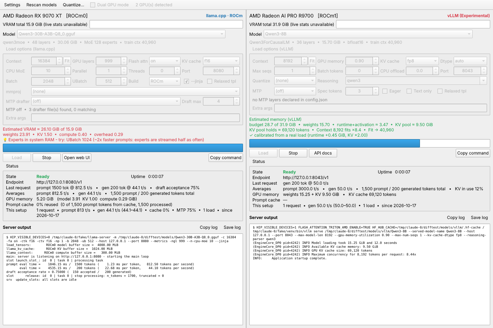
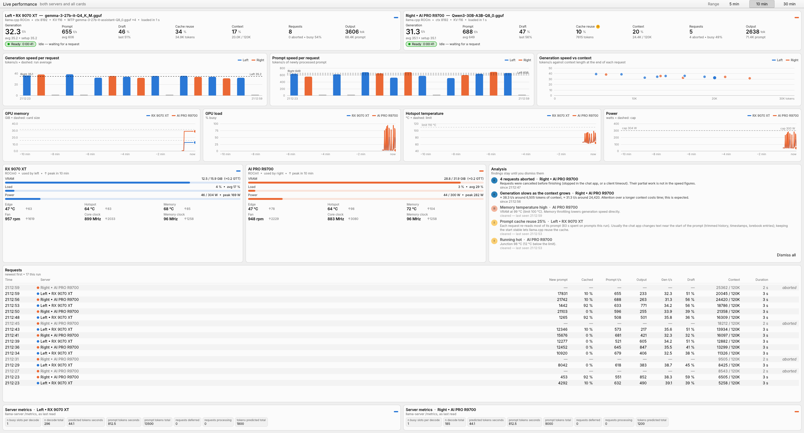
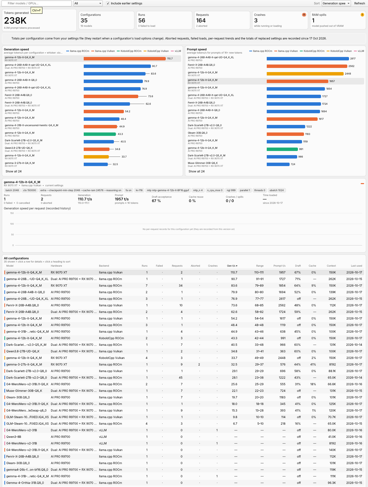

# LLM Duo (Rust + Qt 6 / Kirigami)

Run one **llama-server**, **KoboldCpp**, **vLLM** or **Radiance** server per GPU from a two-pane
KDE Plasma GUI.

- one pane per GPU, each with its own backend (llama.cpp, KoboldCpp ROCm/Vulkan, Radiance, vLLM — experimental)
- per-(GPU, model) options saved automatically; live VRAM estimate while you change them; **Fit**
- Dual GPU mode (one model across both cards: layer/row/tensor split for llama.cpp/KoboldCpp,
  pipeline/tensor parallel for vLLM)
- MTP drafter detection, relaxed chat templates, calibration from real loads, long-term speed stats
- live status (state, prompt/gen speed, prompt-cache reuse, GPU buffers, VRAM/busy from sysfs)
- detection of models pushed out of VRAM, crash reports saved to `logs/`, optional chime
- FP8 quantize tool for vLLM models
- **Dashboard** (live performance) and **History** (every configuration) windows - see below



*(Captured headless against stand-in servers, so it shows Qt's Fusion style; on Plasma it uses Breeze.)*

## Layout

| Path | What it is |
|---|---|
| `src/duo/` | all application logic in plain Rust (no Qt): GGUF/safetensors readers, VRAM estimates, dual-GPU and vLLM planners, process control, log/metrics parsing, settings, stats |
| `src/bridge.rs` | the cxx-qt bridge: one QML singleton (`Backend`) that forwards to `src/duo` |
| `cpp/launcher.cpp` | creates the `QApplication` + QML engine (needed for the Plasma style) |
| `qml/` | the Kirigami / Qt Quick Controls user interface |
| `assets/` | tooltip texts and the FP8 quantizer script (embedded into the binary) |
| `packaging/` | `.desktop` file and icon |

## Build on Ubuntu 26.04 LTS

These steps work on Kubuntu 26.04 and on Ubuntu 26.04 with any desktop (the KDE look needs the
packages from step 1; on GNOME the window simply uses the Qt Fusion style if the KDE desktop
style isn't installed).

### 1. System packages

```bash
sudo apt update
sudo apt install build-essential pkg-config git curl lld clang-format \
    qt6-base-dev qt6-base-dev-tools qmake6 \
    qt6-declarative-dev qt6-declarative-dev-tools \
    qml6-module-qtquick qml6-module-qtquick-controls qml6-module-qtquick-layouts \
    qml6-module-qtquick-templates qml6-module-qtquick-window qml6-module-qtquick-dialogs \
    qml6-module-qtqml-workerscript \
    qml6-module-org-kde-kirigami qml6-module-org-kde-desktop \
    vulkan-tools
```

- `qmake6` is how the build finds Qt; `qt6-declarative-dev-tools` provides `qmltyperegistrar` and
  `qmlcachegen`, which the build runs for the QML module.
- `qml6-module-org-kde-kirigami` and `qml6-module-org-kde-desktop` give the Plasma look
  (already installed on Kubuntu).
- `vulkan-tools` (`vulkaninfo`) is only needed for KoboldCpp's / llama.cpp's Vulkan builds; it maps
  each GPU to its Vulkan device number.
- The chime uses `paplay`, `pw-play` or `aplay`, whichever is installed (Ubuntu desktops have one).

### 2. Rust toolchain

cxx-qt 0.10 needs Rust 1.85 or newer. Use rustup (Ubuntu packages it):

```bash
sudo apt install rustup
rustup default stable
rustc --version        # 1.85 or newer
```

(or install rustup from https://rustup.rs).

### 3. Build and run

```bash
cd llm-duo
export QMAKE=/usr/bin/qmake6      # tells cxx-qt which Qt to use
cargo build --release
./target/release/llm-duo
```

The first build downloads the crates (cxx, cxx-qt, serde_json, regex, libc) and compiles the
C++ side; it takes a few minutes. `qmake6 -query QT_VERSION` shows which Qt is used (6.10 on 26.04).

### 4. Install for your user (optional)

```bash
scripts/install-local.sh            # builds, then installs to ~/.local/bin + menu entry + icon
scripts/install-local.sh --uninstall
```

After installing, LLM Duo appears in the application launcher (Development / Utilities).

## Where settings and data live

Settings live in `~/.config/llm-duo/llm_duo_settings.json`; logs, relaxed templates, the
quantizer script and the chime sound in `~/.local/share/llm-duo/`.

To keep everything (settings, `logs/`, `templates/`, `tools/`) in one folder instead, set
`LLM_DUO_DIR=/path/to/folder`, or put the binary next to an existing `llm_duo_settings.json`
(portable mode).

## Performance dashboards

**Dashboard** (toolbar) shows both servers and every card on one screen (sized for a 1440-pixel-high
display). Request figures come from llama.cpp for now; for KoboldCpp and vLLM only the GPU graphs fill in.

- one strip per server: last and average generation / prompt speed, draft (MTP) acceptance, prompt-cache
  reuse, context in use, requests and aborts, plus what it is doing right now (prompt progress)
- per-request generation and prompt speed and speed against context, coloured by server
- GPU memory, load, hotspot temperature and power over the last 5 / 10 / 30 minutes, one line per card;
  per card: edge / hotspot / memory temperature, fan and clocks with their peaks (amdgpu sysfs; sampled
  even while the window is closed)
- one request log for both servers, and each server's llama-server `/metrics`
- analysis: low draft acceptance, prompt cache not reused, context nearly full, cards hot or power-limited,
  VRAM full or spilled, uneven load in Dual GPU mode, slower or faster than the setup's history. Findings stay
  until you dismiss them (marked "cleared" once the condition is gone); with none left, the status lines show.



**History** lists every configuration (GPU/backend + model + load options) with runs, failed and
cancelled loads, requests, aborted requests, crashes, RAM spills, speeds and draft / cache figures,
charts the fastest setups, and shows the request-by-request trend of the one you click.

The totals come from the `stats` section of the settings file. LLM Duo also appends every load,
request, abort and crash to `~/.local/share/llm-duo/history.jsonl`, and keeps the totals of a
configuration there when its load options change (the settings file starts those totals over).



## Radiance backend

Pick **Radiance** for a pane in Settings and fill in the Radiance section:

| setting | typical value |
|---|---|
| Radiance binary | `~/radiance/build/bin/radiance` (rad-info and rad-convert are found beside it) |
| Radiance home | `~/radiance/build/radiance_home` (the engine's plugins) |
| Radiance models folder | `/mnt/1TB/Radiance` |
| Recipes folder | `~/radiance/data/recipes` |

The model list shows `.rad` containers and checkpoint folders (served at their own precision).
`RADIANCE_HOME` and `HIP_VISIBLE_DEVICES` go on Radiance's own command line only, never into your
shell, so the other card stays visible to everything else. *Copy command* gives the exact line,
the same as the launch you tested by hand:

```
RADIANCE_HOME=… HIP_VISIBLE_DEVICES=0 radiance --model …/gemma4-31b-heretic-ara-w4a8.rad \
  --port 8080 --max-model-len 262144 --kv-cache-dtype fp8 --max-num-seqs 1 \
  --max-num-batched-tokens 2048 --vision-tower-placement ram
```

**Memory.** Radiance claims the whole card at startup and splits it between weights and its KV
pool itself, so a full VRAM bar is normal. LLM Duo doesn't guess the split. It shows what Radiance
reported for the same memory settings: KV cache type, Max seqs, Batch tokens, headroom,
placements, host pool and spec tokens. **Fit** reads that figure. The first time for a set of
memory settings, Fit runs a short *plan check*: it starts radiance on a spare port, reads the
`kv cache … tokens of context` line and stops it. If the start fails, it bisects the context.
Every real load records the figure as well. Spill detection and VRAM calibration are off for
Radiance, because it pins host memory on purpose (the embedding, and the vision tower set to
`ram`).

**Defaults.** Max seqs is 1, because the engine's own 256 leaves only a few thousand tokens of
context on a 32 GB card. KV cache defaults to fp8; the engine's default is bf16.

**Prompt lookup** (Radiance 1.15) drafts from the sequence's own n-grams with no draft model. Set
Prompt lookup to the most drafts a step; it replaces Spec tokens while it is on. A container with
a draft head refuses it, so use Spec tokens there, and lookup fills in where the head declines.

**Embedding, rerank and decision models** load like any other and show their endpoints in the
model summary. Embedding and rerank models read each input whole, so Batch tokens has to reach the
longest input. A model with no KV cache has nothing for Fit to measure, and Fit says so.

**API key.** With Radiance 1.15.1 or later, the key from Settings reaches the server through
`--api-key-env`, so it doesn't show in `ps`. Older builds get `--api-key` on the command line.

**Dual GPU mode** runs `--tp 2` (tensor parallel), because Radiance has no layer split. The KV
pool is sized to the tighter card, so an R9700 + 9070 XT pair usually holds less context than the
R9700 alone. The estimate says so.

**Status and dashboards.** These come from the startup log (KV pool, full-length sessions,
arena, the `settled at … free` line) and from `/metrics` and `/stats` (decode step time and
best/recent floor, throughput, KV in use, draft acceptance, preemptions, evictions). Each request
in the dashboard and history is derived from counter deltas between idle polls. A client
disconnect counts as an abort. *Open dashboard* opens Radiance's own web dashboard.

**Convert…** (top bar, shown while a pane uses Radiance) runs `rad-convert` on a checkpoint
folder. It takes a recipe from the recipes folder, read each time the window opens, and fills in
the `--set` keys the recipe's header asks for. It can also add a draft model, a max context, an
environment (such as `CALIB=`) and plan-only. The new container appears in the model list when it
finishes.

Recipes that read `$CALIB` show a warning until it is set, and those that use repository-relative
codebooks run from the Radiance checkout, so the recipes folder has to stay inside it. Decision
checkpoints are recognised: clef gets `decision.type=clef`, `--arch clef` and its
`joint_head.safetensors`, and Laya gets `decision.type=laya`. Laya folders with no `config.json`
are listed too. Naming `--arch` in Extra args turns the clef additions off.

The log parsing is written from Radiance's documentation, not a live log. If a status line stays
empty or Fit says it couldn't read the pool, send the startup log and the parser can be adjusted.

## Troubleshooting

| Problem | Fix |
|---|---|
| `Could not find qmake` / wrong Qt picked | `export QMAKE=/usr/bin/qmake6` before `cargo build` |
| `module "org.kde.kirigami" is not installed` at start | `sudo apt install qml6-module-org-kde-kirigami` |
| `module "QtQuick.Dialogs" is not installed` | `sudo apt install qml6-module-qtquick-dialogs` |
| Looks like plain Fusion, not Breeze | `sudo apt install qml6-module-org-kde-desktop` (or force a style: `QT_QUICK_CONTROLS_STYLE=org.kde.desktop llm-duo`) |
| Linker errors mentioning `cxx_qt_init_...` or `ld.bfd` | `sudo apt install lld` and build with `RUSTFLAGS="-C link-arg=-fuse-ld=lld" cargo build --release` |
| Need the QML engine's own messages | run from a terminal: `QT_LOGGING_RULES="qml.debug=true" llm-duo` |

## Development

The logic in `src/duo` has unit tests that run without Qt:

```bash
cargo test     # needs the Qt dev packages too, since the crate links Qt
```

## Changelog

### 1.0.0

First release.

Added:

- Prompt lookup, N-gram min and N-gram max controls for Radiance 1.15.
- Prompt lookup and forced preemption figures in the Radiance status line.
- Model kind and endpoints in the model summary, for embedding, rerank and decision models.
- clef and Laya recognised in Convert, with Laya folders listed as sources.
- A Batch tokens limit of 262144, and a warning when it's too low for an embedding or rerank model.

Changed:

- With Radiance 1.15.1 or later, the API key goes through `--api-key-env`, so it doesn't show in
  `ps`. It is also masked in the log and reports.

Fixed:

- Recipes with repository-relative codebooks run from the Radiance checkout, instead of failing
  with `vq=… cannot be opened`.
- The `CALIB` warning appears for recipes that need it.
- Startup refusals show the real reason: CWSR, plugin refusals, `--spec-ngram` and `--api-key-env`.
- Fit says when a model has no KV cache, instead of asking for a startup log.
- Prefix-cache log lines no longer overwrite the KV pool figure.
- Stale Radiance help text.
